<div align="center">



<br/><br/>

<a href="https://www.linkedin.com/in/fellipe-cavalcanti-669164321/"></a>&nbsp;
<a href="mailto:fellipecb8@gmail.com"></a>&nbsp;
<a href="https://brasileleicaorush.vercel.app/"></a>

</div>

---

### 📌 Sobre mim

```java
public class Fellipe {
    String curso      = "Análise e Desenvolvimento de Sistemas — Faculdade Projeção";
    String local      = "Brasília - DF";
    String[] stack    = {"Java", "JavaScript", "HTML", "CSS"};
    String[] devops   = {"Docker", "GitHub Actions", "CI/CD", "Git"};
    String objetivo   = "Estágio ou vaga júnior em Desenvolvimento de Software";
}
```

- 🎮 Criei um **jogo de plataforma completo em JavaScript puro**, sem engine e sem dependências
- 🐳 Estudando conteinerização com **Docker** e automação de pipelines com **GitHub Actions**
- 🎓 Certificados: *DOCKER Completo do Zero ao Avançado* e *GitHub Actions – The Complete Guide* (Udemy, 2026)
- 📫 Fale comigo: **fellipecb8@gmail.com**

---

### 🛠️ Tecnologias

<div align="center">

**Linguagens e Web**


**DevOps e Ferramentas**


</div>

---

### 🚀 Projeto em destaque

<div align="center">

<a href="https://brasileleicaorush.vercel.app/">
  
</a>

#### [BRASIL — ELEIÇÃO RUSH](https://github.com/Felpzcvl/BRASIL-ELEICAO-RUSH)

Jogo de plataforma no estilo dos clássicos de 16 bits, feito **100% em HTML5 Canvas + JavaScript puro**.


</div>

| Destaque | Detalhes |
|---|---|
| 🕹️ **Conteúdo** | 6 fases em 3 zonas, 3 chefes e fase especial em túnel 3D |
| ⚙️ **Física** | Rampas, loopings e colisão por altura de tile, no modelo clássico de 16 bits |
| 🎨 **Gráficos** | Cenários e personagens desenhados por código, com parallax em camadas |
| 🔊 **Áudio** | Trilha chiptune e efeitos sintetizados com Web Audio API |
| 📱 **Plataformas** | Teclado, controle e toque no celular; progresso salvo no navegador |

<div align="center">

[](https://brasileleicaorush.vercel.app/)
[](https://github.com/Felpzcvl/BRASIL-ELEICAO-RUSH)

</div>

---

### 📊 Estatísticas

<div align="center">


</div>

<div align="center">
<sub><code>~/felpzcvl</code> · feito com café, código e curiosidade</sub>
</div>
